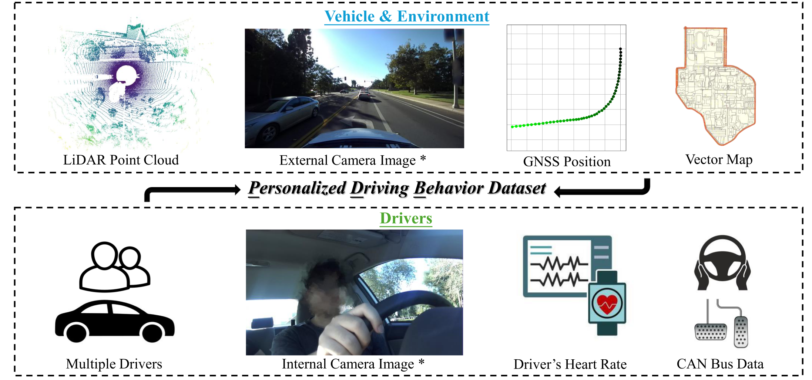
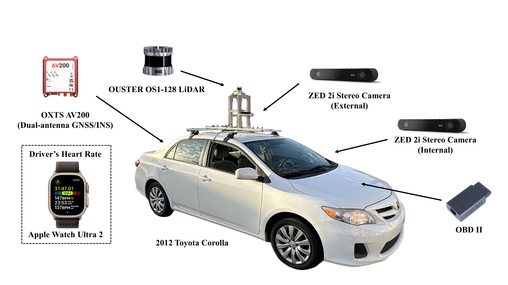
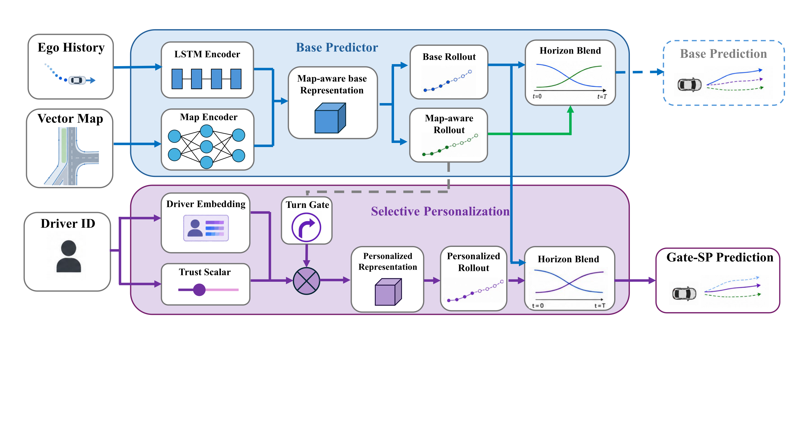
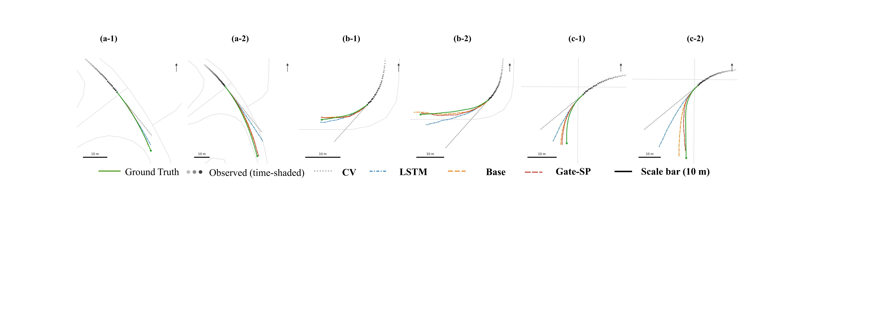

# PDB: Not All Drivers Are the Same – A Personalized Dataset for Understanding Driving Behavior

[](https://arxiv.org/abs/2503.06477)

**Paper:** https://arxiv.org/abs/2503.06477

> **Status:** The dataset is currently being processed and anonymized. Data and code will be released in this repository once that is complete.



## Overview

Driving behavior varies across individuals, yet most public driving datasets do not preserve driver identity or control for factors that affect driving style. The **Personalized Driving Behavior (PDB)** dataset is a multimodal dataset collected from **9 drivers** who drove the **same vehicle** along the **same route** under comparable conditions, so that differences between recordings are easier to attribute to the driver rather than to the vehicle or the road.

- 111,060 LiDAR point clouds (about 3.1 hours at 10 Hz) and more than 1.33 million images
- Synchronized recordings of the surrounding environment, vehicle dynamics, and driver state
- Pseudonymous driver IDs preserved across recordings
- **PDB-Traj**, a personalized trajectory prediction benchmark derived from the raw recordings

## Sensor Setup

The test vehicle is a 2012 Toyota Corolla equipped with the sensor suite below.



| Data | Sensor | Frequency |
|---|---|---|
| Point cloud | Ouster OS1-128 LiDAR | 10 Hz |
| Images (external and in-cabin) | ZED 2i stereo cameras | 30 Hz |
| GNSS position | OXTS AV200 | 100 Hz |
| CAN-bus signals (speed, steering angle, gas pedal, brake pressure) | OBD-II interface | 31–83 Hz, event-driven |
| IMU | ZED 2i stereo camera | 400 Hz |
| Driver heart rate | Apple Watch Ultra 2 | 0.2 Hz on average |

## PDB-Traj Benchmark

PDB-Traj contains **1,309 trajectory segments**, each spanning 10 seconds at 10 Hz. Every segment includes the ego-vehicle trajectory, the trajectories of surrounding agents, and the driver ID. The task is to predict the future ego positions over a 3 s or 5 s horizon from a 3 s observation.

The paper also introduces **Gated Selective Personalization (Gate-SP)**, a driver-aware baseline that adds driver-specific corrections on top of a map-conditioned predictor, regulated by a turn gate and a per-driver trust scalar.



Results on the PDB-Traj test split (meters, lower is better):

| Method | ADE (3s→3s) | FDE (3s→3s) | ADE (3s→5s) | FDE (3s→5s) |
|---|---|---|---|---|
| Constant velocity | 1.59 | 4.05 | 3.91 | 10.23 |
| CTRV | 1.36 | 3.53 | 3.46 | 9.40 |
| LSTM | 1.00 | 2.55 | 2.53 | 6.85 |
| Transformer | 2.43 | 5.08 | 4.73 | 11.13 |
| Transformer + driver embedding | 1.81 | 4.28 | 4.01 | 9.82 |
| Trajectron++ | 1.46 | 3.75 | 4.07 | 10.32 |
| Base (map-conditioned, no personalization) | 0.89 | 2.15 | 1.96 | 5.01 |
| **Gate-SP** | **0.88** | **2.15** | **1.91** | **4.85** |



## Privacy

Informed consent was obtained from all participants. Driver IDs are pseudonymous, and facial data will only be made available under a separate data use agreement.

## Citation

```bibtex
@article{wei2025pdb,
  title   = {PDB: Not All Drivers Are the Same -- A Personalized Dataset for Understanding Driving Behavior},
  author  = {Wei, Chuheng and Qin, Ziye and Li, Siyan and Zhang, Ziyan and Zhao, Xuanpeng and Abdelraouf, Amr and Gupta, Rohit and Han, Kyungtae and Wang, Ziran and Barth, Matthew J. and Wu, Guoyuan},
  journal = {arXiv preprint arXiv:2503.06477},
  year    = {2025}
}
```
